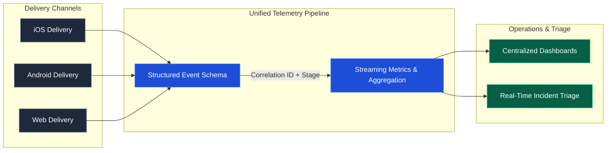
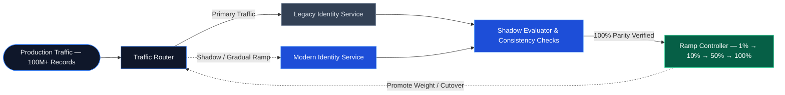
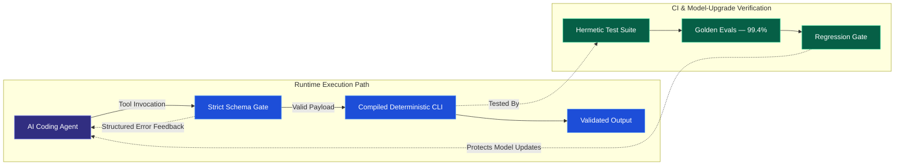
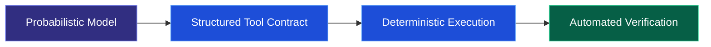

<div align="center">


<a href="https://doronf3.github.io"></a>
<a href="https://linkedin.com/in/doronf3"></a>
<a href="mailto:doronfi3@gmail.com"></a>

<br><br>


</div>

---

## ⚡ Engineering at a Glance

<table>
<tr>
<td align="center" width="25%">

### 100M+

**Active Records**

Migrated across identity infrastructure

</td>
<td align="center" width="25%">

### 0

**Downtime**

During large-scale service migration

</td>
<td align="center" width="25%">

### 99.4%

**Tool Accuracy**

Deterministic AI developer tooling

</td>
<td align="center" width="25%">

### 100%

**Traceability**

Across delivery channels

</td>
</tr>
</table>

---

## 🏛️ Featured Systems

### 📊 1. Multi-Channel Pipeline Observability

> **Building end-to-end visibility into distributed mobile and web delivery pipelines.**



* **Problem:** Distributed delivery across iOS, Android, and web created fragmented visibility, making it hard to pinpoint where notifications failed.
* **Architecture:** Standardized structured event schemas across every delivery stage, unified cross-platform telemetry, and aggregated streaming metrics into centralized triage dashboards with end-to-end correlation.
* **Impact:** **100% channel traceability** with substantially faster incident investigation.

<details>
<summary><b>🔍 Technical Deep Dive</b></summary>

<br>

The core design principle was treating observability as part of the **system contract** rather than an afterthought. Every delivery stage emits structured events with enough context to correlate a request across services and platforms, enabling:

* End-to-end request reconstruction
* Stage-level failure identification
* Real-time streaming aggregation
* Cross-platform delivery comparison
* Faster root-cause analysis

</details>

---

### 🔄 2. Zero-Downtime Service & Identity Migration

> **Migrating 100M+ active user and device records without interrupting production traffic.**



* **Problem:** A deprecated identity service had to be replaced while preserving production availability and preventing user mis-targeting.
* **Strategy:** **Dark launch** → **Live shadow evaluation** → **Automated consistency verification** → **Incremental traffic ramp** → **Controlled cutover**.

| Metric              |                           Result |
| ------------------- | -------------------------------: |
| Records migrated    |                        **100M+** |
| Production downtime |                            **0** |
| Data consistency    |                **100% verified** |
| Deployment strategy | **Dark launch + shadow traffic** |

<details>
<summary><b>🔍 Why This Architecture</b></summary>

<br>

Offline validation alone cannot prove behavioral equivalence under real production load. Shadow evaluation turns a high-risk cutover into a controlled, reversible rollout:


</details>

---

### 🤖 3. Deterministic AI Developer Tooling

> **Making AI coding workflows behave like reliable software systems.**



* **Problem:** Raw natural-language prompt instructions are fragile—leading to hallucinated commands, invalid CLI syntax, context bloat, and silent regressions after model updates.
* **Approach:** Moved critical workflows out of prompts into compiled CLI interfaces with strict schemas, explicit validation gates, hermetic tests, and automated golden eval suites.
* **Impact:** **99.4% tool execution accuracy** with automated regression protection across model upgrades.

<details>
<summary><b>🔍 Engineering Principle</b></summary>

<br>

The goal is not to make an LLM deterministic—it is to make the **interface around the LLM deterministic**.



</details>

---

## 🧰 Technical Stack

### Languages
<p>
  
  
</p>

### Distributed Systems & Backend
<p>
  
  
  
  
  
</p>

`Distributed Messaging` · `Event-Driven Architecture` · `Microservices` · `APIs` · `RPC` · `Data Pipelines`

### AI & Developer Infrastructure
<p>
  
  
  
  
  
</p>

`Agent Harnesses` · `Evaluation Pipelines` · `Deterministic Tooling` · `Regression Testing` · `Developer Experience`

---

## 🧠 Engineering Principles

<table>
<tr>
<td width="50%" valign="top">

### Reliability
Design systems around failure rather than assuming success.

</td>
<td width="50%" valign="top">

### Determinism
Move critical behavior from implicit assumptions into explicit contracts.

</td>
</tr>
<tr>
<td width="50%" valign="top">

### Observability
If a system cannot explain what happened, it is difficult to operate.

</td>
<td width="50%" valign="top">

### Automation
Anything repeatedly verified manually should eventually become a test.

</td>
</tr>
</table>

---

## 🔬 Areas of Interest

```text
Distributed Systems                 AI Developer Infrastructure       Developer Infrastructure
├── High-scale backend services     ├── AI agents                     ├── CLI tooling
├── Event-driven architectures      ├── Tool execution                ├── Automation
├── Messaging & streaming           ├── Agent harnesses               ├── CI/CD
├── Service reliability             ├── Evaluation systems            ├── Observability
└── Zero-downtime migrations        └── Regression testing            └── Developer experience
```

---

## 📈 GitHub Activity

<div align="center">

<picture>
  <source media="(prefers-color-scheme: dark)" srcset="https://github-readme-stats.vercel.app/api?username=doronf3&show_icons=true&hide_border=true&count_private=true&include_all_commits=true&bg_color=0D1117&title_color=60A5FA&icon_color=3B82F6&text_color=E2E8F0">
  
</picture>
<picture>
  <source media="(prefers-color-scheme: dark)" srcset="https://github-readme-stats.vercel.app/api/top-langs/?username=doronf3&layout=compact&hide_border=true&langs_count=8&bg_color=0D1117&title_color=60A5FA&text_color=E2E8F0">
  
</picture>

<br><br>

<picture>
  <source media="(prefers-color-scheme: dark)" srcset="https://github-readme-streak-stats.herokuapp.com/?user=doronf3&hide_border=true&background=0D1117&ring=3B82F6&fire=60A5FA&currStreakLabel=60A5FA&sideLabels=E2E8F0&currStreakNum=FFFFFF&sideNums=FFFFFF&dates=94A3B8">
  
</picture>

<br><br>

<picture>
  <source media="(prefers-color-scheme: dark)" srcset="https://raw.githubusercontent.com/doronf3/doronf3/output/github-snake-dark.svg">
  <source media="(prefers-color-scheme: light)" srcset="https://raw.githubusercontent.com/doronf3/doronf3/output/github-snake.svg">
  
</picture>

</div>

---

## 🏗️ Architecture Dossier

<div align="center">

I write detailed technical breakdowns of systems, architecture decisions, migrations, and engineering trade-offs.

<br>

<a href="https://doronf3.github.io"></a>

<br><br>

**System Designs · Architecture Case Studies · Engineering Writeups**

---

### Building systems that scale.
### Building tools that make them easier to build.

<br>

<a href="https://doronf3.github.io">Website</a> •
<a href="https://linkedin.com/in/doronf3">LinkedIn</a> •
<a href="mailto:doronfi3@gmail.com">Email</a>

<br><br>


</div>
